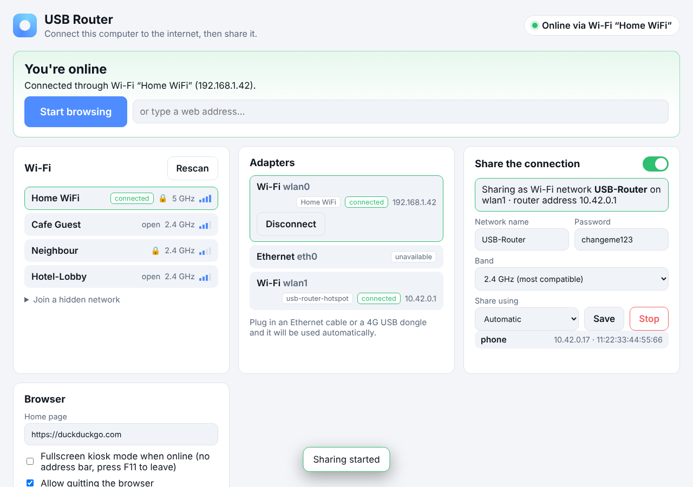
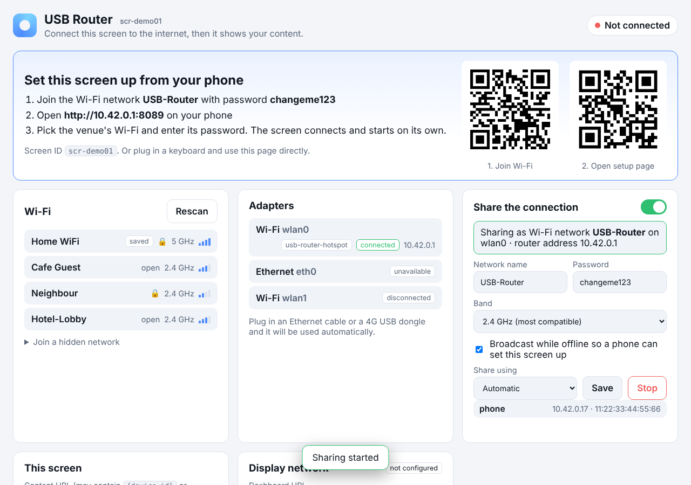

# USB Router — plug-in player for a display network

A bootable USB stick that turns a HDMI compute stick (or any PC) into a signage
player with its own router. Plug it into a screen, power on, and the screen
gets itself online and shows your content fullscreen. No keyboard needed: the
screen can be set up from a phone, or pre-configured so nobody touches it at all.

- **Connects** over Wi-Fi, Ethernet or a 4G dongle, with hotel/café sign-in
  pages detected and surfaced.
- **Shows your content** in a custom Chromium-based browser: fullscreen kiosk,
  per-screen URLs, portrait rotation, a watchdog that retries when the content
  server is down, and scheduled reloads.
- **Routes**: once online it can share the connection as a Wi-Fi hotspot or
  over Ethernet, and while offline it broadcasts a setup hotspot so a phone can
  configure it.
- **Reports in** to a small fleet dashboard (included) where you see every
  screen and change its URL, rotation or reboot it remotely.

Nothing is installed on the host machine. Pull the stick and it is untouched.



> A monitor cannot boot a USB stick by itself. Each screen needs a small HDMI
> compute stick for this to run on. **See [HARDWARE.md](HARDWARE.md) before ordering.**

## Setting up a screen: three ways

**1. Zero-touch (recommended for a batch).** Before writing the sticks, put the
venue Wi-Fi and the content URL in `usb-router.conf`:

```ini
homepage = https://signage.example.com/play?screen={device_id}
wifi_ssid = Venue-Staff
wifi_password = ********
fleet_url = https://signage.example.com
fleet_token = ********
```

Plug in, power on, done. The screen joins the Wi-Fi, opens the URL with its own
ID filled in, and appears in the dashboard where you can name it and change
what it shows.

**2. From a phone (screen mounted, no keyboard).** With nothing pre-configured
the screen shows two QR codes after about 25 seconds offline: scan the first to
join its setup hotspot, the second to open its setup page. Pick the venue Wi-Fi,
type the password, and the screen connects and starts. The hotspot drops when
the screen's single Wi-Fi card switches over; that is expected.



**3. With a keyboard.** The same setup page is on the screen itself. Ctrl+N
brings it back any time; F11 toggles fullscreen.

## What happens at boot

1. Debian 12 live boots (BIOS and UEFI). NetworkManager starts; wired and
   provisioned Wi-Fi connections come up on their own.
2. The connection manager (`app/server.py`) starts on `http://127.0.0.1:8080`
   and creates auto-connect profiles for the `wifi_ssid*` entries in the config.
3. The `kiosk` user logs in on tty1, X starts, rotation and HDMI audio are set,
   and the browser opens the setup page with no toolbar.
4. Offline for 25 s with `setup_hotspot = true`: the setup hotspot and QR codes appear.
5. Online: the browser goes fullscreen on the content URL (`kiosk = true`), the
   sharing hotspot starts if a spare adapter exists, and heartbeats go to the
   fleet dashboard if configured.
6. Content server down? The browser shows a "Content unavailable, retrying"
   screen with the screen ID and retries with backoff. Network back? It reloads.
7. Saved networks, settings and downloads persist on the stick.

### Which adapter becomes the hotspot

| Internet comes from | Hotspot runs on |
|---|---|
| Ethernet cable or 4G dongle | the built-in Wi-Fi card |
| Wi-Fi | a second AP-capable USB adapter, otherwise a free Ethernet port (wired sharing), otherwise none |
| nothing yet (setup mode) | the built-in Wi-Fi card, until it is needed to join a network |

NetworkManager's shared mode provides DHCP (dnsmasq), DNS forwarding and NAT.
Hotspot clients get `10.42.0.x`; the stick is `10.42.0.1`.

## What is in this folder

| Path | What it is |
|------|------------|
| `app/` | Connection manager web app (Flask): Wi-Fi scan/connect, captive-portal detection, hotspot, zero-touch provisioning, settings, QR codes, fleet client. |
| `browser/browser.py` | Custom browser (PyQt6 / Qt WebEngine). Kiosk fullscreen, F11, HTML5 fullscreen, watchdog, scheduled reload, remote URL changes. |
| `fleet/` | Fleet dashboard: one page listing every screen; change URL, rotation, reload interval, reboot; group updates. |
| `system/`, `scripts/` | systemd units, polkit rules, NetworkManager config, the X session, `install-local.sh` for installing on an existing Debian machine. |
| `build/` | `build-iso.sh` (live-build, native or Docker) and `make-usb.sh` (writes the ISO, adds persistence and config partitions). |
| `config/usb-router.conf.example` | Every setting, with comments. |
| `tests/` | pytest suite (22 tests) against a fake NetworkManager, plus the fleet dashboard. |
| `HARDWARE.md` | Compute sticks, flash drives, adapters and power supplies to order. |

## Build the sticks

You need a Linux machine (or Docker) and flash drives of 8 GB or more.

```bash
# 1. Build the ISO once (20-60 min, ~6 GB scratch)
sudo apt install live-build && sudo ./build/build-iso.sh
#    or on any Linux with Docker:
./build/build-iso.sh --docker

# 2. Edit config/usb-router.conf.example (or a copy) with your Wi-Fi, URL and fleet settings.

# 3. Write each stick. THIS ERASES THE STICK. Find the device with lsblk first.
sudo ./build/make-usb.sh build/out/usb-router-YYYYMMDD.iso /dev/sdX
```

`make-usb.sh` lays the stick out as:

| Partition | Label | Purpose |
|---|---|---|
| 1-2 | (ISO) | read-only live system |
| 3 | `persistence` | ext4: saved Wi-Fi networks, settings, downloads |
| 4 | `USBROUTER` | FAT32: `usb-router.conf`, visible on Windows and macOS |

`make-usb.sh` copies `config/usb-router.conf.example` onto the `USBROUTER`
partition as `usb-router.conf`, so edit that file before writing a batch, or
edit it on each stick afterwards from any computer. For a per-screen ID set
`device_id` on each stick; otherwise one is derived from the hardware.

Boot the compute stick from USB (usually F7, F12, Esc or Del at power-on;
Secure Boot off; "power on after power loss" on).

## Run it without a stick

```bash
# Web app only, with a fake NetworkManager (any OS with Python 3):
pip install -r requirements-dev.txt
USB_ROUTER_MOCK=1 python3 app/server.py          # http://127.0.0.1:8080

# Browser against that page (needs PyQt6 + PyQt6-WebEngine):
pip install -r requirements-browser.txt
python3 browser/browser.py                       # add --kiosk to test fullscreen

# Fleet dashboard:
FLEET_TOKEN=secret FLEET_ADMIN_PASSWORD=pw python3 fleet/server.py   # http://127.0.0.1:4010

# Full install on an existing Debian 12 / Ubuntu 22.04+ machine or mini-PC:
sudo ./scripts/install-local.sh                  # --no-x for the web app only

# Tests:
USB_ROUTER_MOCK=1 python3 -m pytest tests/
```

## Configuration

All keys are in `config/usb-router.conf.example`. The important ones:

| Key | Default | Meaning |
|---|---|---|
| `homepage` | duckduckgo.com | Content URL. `{device_id}` and `{device_name}` are replaced |
| `kiosk` | `true` | Fullscreen, no toolbar, once online |
| `rotation` | `normal` | `left` / `right` for portrait screens, `inverted` |
| `reload_every` | `0` | Reload the content every N minutes |
| `device_id`, `device_name` | derived, empty | Identity in URLs and the dashboard |
| `wifi_ssid[_2,_3]`, `wifi_password[_2,_3]` | empty | Zero-touch Wi-Fi profiles created at boot |
| `setup_hotspot` | `true` | Broadcast the hotspot while offline for phone-based setup |
| `hotspot_enabled`, `hotspot_ssid`, `hotspot_password`, `hotspot_band` | on, `USB-Router`, `changeme123`, `bg` | Sharing once online, and the name used in setup mode |
| `lan_access`, `admin_pin` | `true`, empty | Serve the setup page to hotspot clients; PIN required for remote changes if set |
| `fleet_url`, `fleet_token`, `fleet_interval` | empty, empty, 60 | Fleet dashboard |
| `allow_exit` | `false` | Quit button / Ctrl+Q |

Environment variables `USB_ROUTER_<KEY>` override the file.

## API

The browser, the page and the dashboard all use the same JSON API on port 8080.

| Method | Path | Purpose |
|---|---|---|
| GET | `/api/status` | Online state, uplink, devices, hotspot, settings, device, fleet, current URL |
| GET | `/api/wifi/scan?rescan=1` | Nearby networks |
| POST | `/api/wifi/connect`, `/api/wifi/forget` | `{ssid, password}` / `{ssid}` |
| POST | `/api/disconnect`, `/api/ethernet` | `{iface}` |
| GET | `/api/check` | Fresh internet / captive-portal check |
| GET, POST | `/api/hotspot` | Status and candidates; `{action: start/stop/restart, iface?}` |
| GET, POST | `/api/settings` | Read / change settings |
| POST | `/api/system` | `{action: reload / restart-browser / reboot / shutdown}` |
| POST | `/api/fleet/ping` | Send a heartbeat now |
| GET | `/api/qr?kind=wifi` or `ui` | PNG QR codes for phone setup |
| GET | `/api/display` | Rotation, used by the X session |
| POST | `/api/browser/go` | `{url?}` leave the setup screen |
| GET | `/api/browser/poll` | What the browser polls: navigate, action, homepage, kiosk, reload interval |
| POST | `/api/browser/report` | `{url}` what the browser is showing |

Changes from the local screen need nothing. Changes from the hotspot side are
allowed when `lan_access` is on (the hotspot password is the gate) and require
the `X-Admin-Pin` header when `admin_pin` is set.

## Browser keyboard shortcuts

| Keys | Action |
|---|---|
| F11 | Toggle fullscreen (also leaves kiosk mode) |
| Esc | Leave HTML5 / window fullscreen, or stop loading |
| Ctrl+N | Setup page |
| Ctrl+L, Ctrl+T, Ctrl+W | Address bar, new tab, close tab |
| Ctrl+R, F5 | Reload |
| Alt+Left / Alt+Right | Back / forward |
| Ctrl+= / Ctrl+- / Ctrl+0 | Zoom |
| Ctrl+Q | Quit (if `allow_exit`) |
| Ctrl+Alt+T | Terminal (for support) |

## Security notes

- The web app runs as the unprivileged `kiosk` user and controls NetworkManager
  and reboot/power-off through polkit rules for the `netdev` group, nothing else.
- Change `hotspot_password` before deploying. In setup mode it is shown on the
  screen on purpose; it is what lets the installer's phone in.
- Set `admin_pin` if screens will keep broadcasting a hotspot in public.
- The fleet token is sent as a Bearer header; run the dashboard behind HTTPS.
- The browser refuses to bypass TLS certificate errors.
- The persistence partition is not encrypted. Wi-Fi passwords are stored on it,
  root-readable only. Treat a stick like a laptop.

## What was and was not verified

- The web app, API and fleet dashboard were exercised end to end against the
  mock backend (22 pytest tests) and through a headless Chromium run of the
  setup, connect, hotspot and captive-portal flows.
- `browser/browser.py` compiles but needs a display and PyQt6; it was not run here.
- The ISO was not built here. `build-iso.sh` is a standard live-build recipe;
  expect one iteration on the first build.
- The on-screen rotation and HDMI audio steps in `scripts/usb-router-session`
  use standard `xrandr`/`pactl` calls and were not run on hardware.

Part of [freebies](../README.md).
